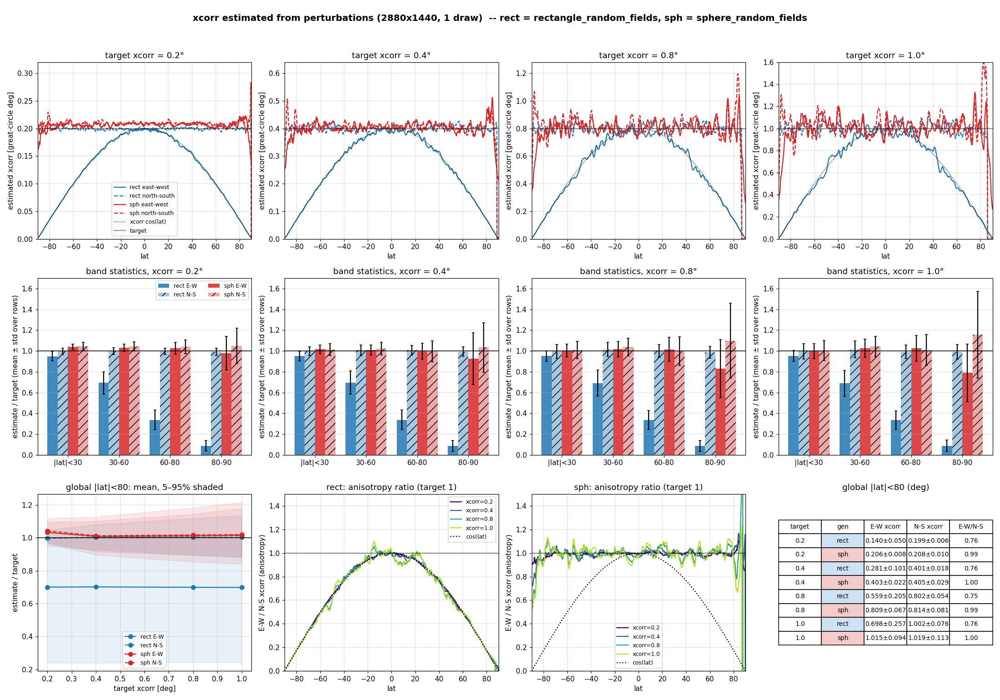

# xcorr recovered from the perturbations: rectangle vs sphere random fields

This note compares the correlation length (xcorr) estimated from perturbations
made by `rectangle_random_fields` (flat lat-lon FFT, "rect") and
`sphere_random_fields` (spherical harmonics, "sph"). It also explains why the
sphere field's xcorr appears to drift near the poles.

## Setup

- Driver: `compare_pert.x <xcorr> 1 2880 1440`, run on 8 MPI ranks with
  `module load ifort-stack`.
- Grid: 2880 x 1440 (0.125 deg). One draw per xcorr.
- xcorr = 0.2, 0.4, 0.8, 1.0 deg. Both generators treat xcorr as a Gaussian
  sigma: `C(d) = exp(-d^2 / (2 xcorr^2))`.
- **Row-based estimate:** for each latitude row, find the distance where the
  correlation drops to `exp(-1/2)` (about 0.607). For a Gaussian, that distance
  equals sigma.
  - East-west: correlation along the row, converted to great-circle degrees.
  - North-south: correlation between that row and the rows north of it, at
    the same longitude.



## Field statistics

| xcorr | gen | std | kurtosis |
|---|---|---|---|
| 0.2 | rect | 0.999 | 3.00 |
| 0.2 | sph  | 1.000 | 3.00 |
| 0.4 | rect | 0.997 | 3.00 |
| 0.4 | sph  | 1.000 | 2.98 |
| 0.8 | rect | 0.994 | 3.02 |
| 0.8 | sph  | 1.000 | 2.93 |
| 1.0 | rect | 0.992 | 3.03 |
| 1.0 | sph  | 1.000 | 2.90 |

Both generators produce N(0,1) values (std 1, kurtosis 3).

## Estimated xcorr, |lat| < 80 (great-circle deg, mean ± std over rows)

| target | gen | east-west | north-south | east-west / north-south |
|---|---|---|---|---|
| 0.2 | rect | 0.140 ± 0.050 | 0.199 ± 0.006 | 0.76 |
| 0.2 | sph  | 0.206 ± 0.008 | 0.208 ± 0.010 | 0.99 |
| 0.4 | rect | 0.281 ± 0.101 | 0.401 ± 0.018 | 0.76 |
| 0.4 | sph  | 0.403 ± 0.022 | 0.405 ± 0.029 | 1.00 |
| 0.8 | rect | 0.559 ± 0.205 | 0.802 ± 0.054 | 0.75 |
| 0.8 | sph  | 0.809 ± 0.067 | 0.814 ± 0.081 | 0.99 |
| 1.0 | rect | 0.698 ± 0.257 | 1.002 ± 0.076 | 0.76 |
| 1.0 | sph  | 1.015 ± 0.094 | 1.019 ± 0.113 | 1.00 |

East-west estimate as a fraction of the target, by latitude band (about the
same for every xcorr):

| band | rect | sph |
|---|---|---|
| \|lat\| < 30 | ~0.95 | ~1.00–1.04 |
| 30–60 | ~0.69 | ~1.01–1.03 |
| 60–80 | ~0.34 | ~1.00–1.02 |
| 80–90 | ~0.09 | ~0.79–0.98 (noisy) |

**Rectangle field.** North-south xcorr is correct. East-west xcorr shrinks
with cos(lat), because the flat FFT keeps a fixed length in degrees of
longitude. Features are squeezed east-west toward the poles.

**Sphere field.** It matches the target in both directions, with an
east-west / north-south ratio of about 1, everywhere except the last few
degrees near the poles.

## Why the sphere xcorr looks wrong near the poles

The generator is fine there. The row-based estimator is what fails near the
poles.

### Check without latitude rows

The check used points spread evenly by area in each region:

1. Correlate every pair of points.
2. Bin the correlation by true great-circle distance.
3. Fit the Gaussian shape.

Each region uses its own mean and variance.

| target | equator (5S–5N, 60° of lon) | 45N (40–50N, 80° of lon) | cap > 80N | cap < 80S | cap > 85N |
|---|---|---|---|---|---|
| 0.2 | 0.224 | 0.226 | 0.226 | 0.218 | 0.211 |
| 0.4 | 0.446 | 0.440 | 0.471 | 0.425 | 0.405 |
| 0.8 | 0.836 | 0.935 | 0.898 | 0.802 | 0.796 |
| 1.0 | 1.041 | 1.139 | 1.075 | 1.024 | 0.926 |

The polar caps are as close to the target as the equator and 45N. Every region
is within about ±10%. That spread is fitting noise from one draw and coarse
distance bins, and it is about the same everywhere.

### Why the row-based estimate fails near the poles

1. **The rings are too short.** A latitude ring at colatitude θ is 2πθ
   around. One degree from the pole that is only about 6°, and the last grid
   row is about 0.4° around. With xcorr = 1°, the whole ring sits inside one or
   a few correlation lengths, so the correlation along it can't decay normally.
2. **Subtracting each row's mean removes real signal.** On a short ring, the
   ring's own mean is mostly the large-scale part of the field. Removing it
   makes the correlation fall off too fast, so xcorr comes out too small.
   - This is why the east-west estimate drops toward zero right at the pole.
   - It is also why the bias grows with xcorr: in the 80–90 band the estimate
     is 0.98 of the target at 0.2 and 0.79 at 1.0.
3. **Distance along the ring isn't the true distance.** Separation is
   measured along the circle of latitude. Near the pole, the great-circle path
   between two points on a ring is noticeably shorter.
4. **There are too few independent samples.**
   - The ring at 85° holds about 30 independent features when xcorr = 1°,
     versus about 360 at the equator.
   - The north-south estimate is also weak there: its 2880 longitudes bunch
     together near the pole, so they behave like only a few samples.
   - This is why the polar curves spike and the error bars blow up. The
     slightly larger scatter in polar variance (std 0.89–1.05) has the same
     cause.

**xcorr = 0.2 deg** is only 1.6 grid cells, so any estimate at that xcorr is
partly limited by the grid.

## Reproducing

Source files in this directory (installed to `<install>/bin`):

| file | purpose |
|---|---|
| `compare_pert.F90` | `compare_pert.x`: writes `latlon_pert.bin` / `sphere_pert.bin` |
| `xcorr_stats.py` | row-based xcorr statistics (the tables above) |
| `plot_xcorr_stats.py` | figure `xcorr_stats.png` |
| `pole_check.py` | point-pair xcorr check by region (needs `scipy`) |
| `run_xcorr_stats.sh` | runs all of the above |

```bash
module load ifort-stack
mkdir run_xcorr && cd run_xcorr
<install>/bin/run_xcorr_stats.sh <install>/bin 2880 1440 8 "0.2 0.4 0.8 1.0"
# -> x<xcorr>/*.bin, xcorr_stats.txt, pole_check.txt, xcorr_stats.png
```

## Recommendation

For high latitudes, estimate xcorr from point pairs binned by great-circle
distance, not from latitude rows. Average over several draws (`ndraw` > 1) to
reduce noise.
